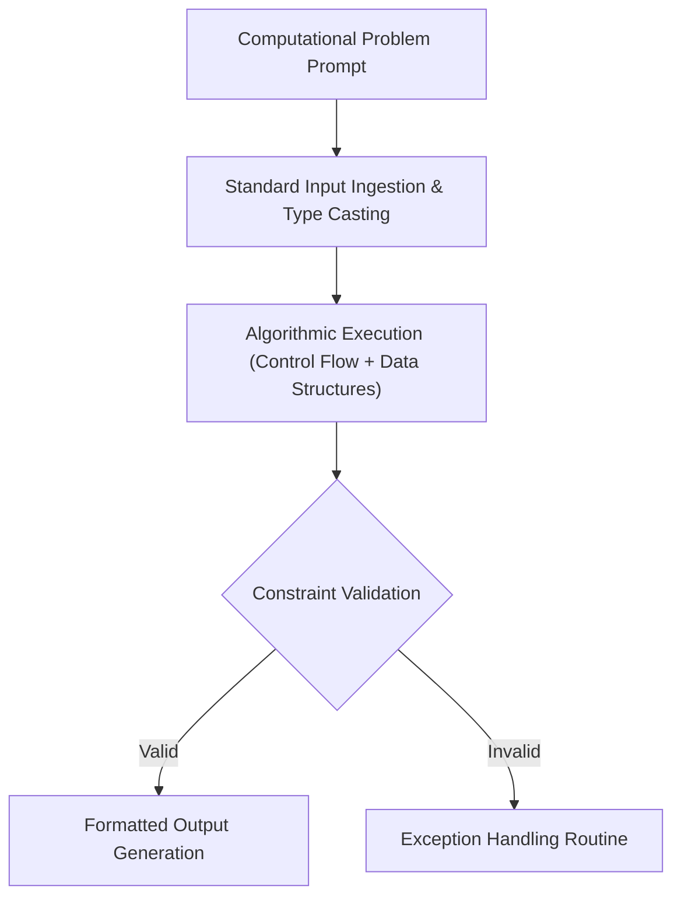

<p align="center">
  
</p>

<p align="center">
  
  
  
  
</p>

<a id="overview"></a>
## 📖 Executive Summary & Overview

Python's expressiveness and extensive ecosystem make it the primary language for modern data science, web services, and automation. True mastery requires writing idiomatic, Pythonic code that leverages list comprehensions, generator expressions, robust exception handling, and standard library collections.

The **Python Foundations Laboratory** (`Python-Assignment`) archives core programming exercises and laboratory coursework developed during BCA studies at Alliance University. The repository covers fundamental algorithmic logic, conditional decision branching, loop iteration patterns, string manipulations, and data structure implementations.

<a id="toc"></a>
## 📑 Table of Contents

- [📖 Executive Summary & Overview](#overview)
- [🎯 Key Features & Capabilities](#features)
- [🏗️ System Architecture & Pipeline](#architecture)
- [🛠️ Tech Stack Breakdown](#tech-stack)
- [⚙️ Reproducible Quickstart & Setup](#setup)
- [📁 Project Directory Layout](#project-layout)
- [👨‍💻 Author & Contributions](#author)

<a id="features"></a>
## 🎯 Key Features & Capabilities

- **Algorithmic Control Flow:** If-elif-else branching, while loops, for loops with enumerate and zip.
- **Data Structure Mechanics:** Deep dives into mutable vs. immutable types: Lists, Tuples, Dictionaries, and Sets.
- **String Parsing & Transformations:** Regex fundamentals, string slicing, formatting (`f-strings`), and tokenization.
- **Defensive Programming:** Error trapping using `try-except-finally` blocks and custom exception raising.

<a id="architecture"></a>
## 🏗️ System Architecture & Pipeline



<a id="tech-stack"></a>
## 🛠️ Tech Stack Breakdown

| Category | Specification | Application |
| :--- | :--- | :--- |
| **Language** | Python 3.10+ | Core scripting and programming |
| **Standard Library** | `math`, `sys`, `collections`, `itertools` | High-efficiency utility operations |
| **Testing & Execution** | Python Interactive CLI, IDLE, VS Code | Execution and debugging environment |

<a id="setup"></a>
## ⚙️ Reproducible Quickstart & Setup

### Prerequisites
- Python 3.8 or higher installed

```bash
# 1. Clone repository
git clone https://github.com/Amaraiah11/Python-Assignment.git
cd Python-Assignment

# 2. Run scripts
python -c "print('Python Foundations Environment Ready')"
```

<a id="project-layout"></a>
## 📁 Project Directory Layout

```text
Python-Assignment/
└── README.md          # Comprehensive Python foundations curriculum & lab guide
```

<a id="author"></a>
## 👨‍💻 Author & Contributions

This project is developed and maintained with high technical rigour by **Amaraiah C**, Software Engineer and Data Analytics Practitioner studying Bachelor of Computer Applications (BCA) at Alliance University.

- 🌐 **GitHub:** [@Amaraiah11](https://github.com/Amaraiah11)
- 💼 **LinkedIn:** [Connect on LinkedIn](https://www.linkedin.com/in/amaraiah-c/)
- 📧 **Institutional Contact:** `camaraiahBCA24@ced.alliance.edu.in`

### 🤝 Contribution Guidelines
Contributions, bug reports, and architectural discussions are welcome!
1. **Fork** the repository: `https://github.com/Amaraiah11/Python-Assignment`
2. **Branch**: `git checkout -b feature/your-feature-name`
3. **Commit**: `git commit -m "feat: enhance feature logic"`
4. **Push**: `git push origin feature/your-feature-name`
5. **Open Pull Request** against the `main` branch.

---

<p align="center">
  <b>⭐ If this codebase or documentation assisted your engineering workflows, please star the repository! ⭐</b>
</p>

<p align="center">
  
</p>
