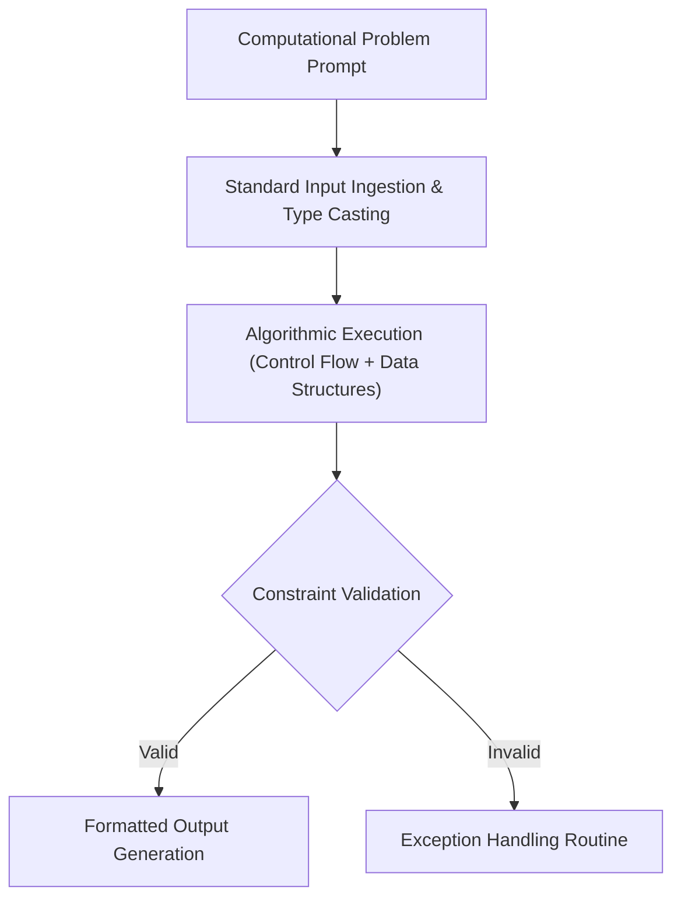

# 🐍 Python Foundations Laboratory — Core Data Structures & Control Flow

<p align="center">
  
</p>

<p align="center">
  <b>Undergraduate Python Programming Laboratory: Mastery of Control Flow, Native Data Structures, and Algorithmic Problem Solving.</b>
</p>

<p align="center">
  
  
  
  
</p>

<p align="center">
  
</p>

---

<a id="table-of-contents"></a>
## 📌 Table of Contents

- [📖 Executive Summary & Overview](#executive-summary--overview)
- [🎯 Key Features & Capabilities](#features)
- [🏗️ System Architecture & Pipeline](#system-architecture--pipeline)
- [🛠️ Tech Stack Breakdown](#tech-stack-breakdown)
- [⚙️ Reproducible Quickstart & Setup](#setup)
- [📁 Project Directory Layout](#project-layout)
- [🔮 Future Improvements & Roadmap](#future-improvements--roadmap)
- [🤝 Contributing Guidelines](#contributing-guidelines)
- [👨‍💻 Author & Contributions](#author--contributions)

---

<a id="executive-summary--overview"></a>
## 📖 Executive Summary & Overview

Python's expressiveness and extensive ecosystem make it the primary language for modern data science, web services, and automation. True mastery requires writing idiomatic, Pythonic code that leverages list comprehensions, generator expressions, robust exception handling, and standard library collections.

The **Python Foundations Laboratory** (`Python-Assignment`) archives core programming exercises and laboratory coursework developed by **Amaraiah C** during BCA studies at Alliance University. The repository covers fundamental algorithmic logic, conditional decision branching, loop iteration patterns, string manipulations, and data structure implementations.

---

<a id="key-features--capabilities"></a>
## 🎯 Key Features & Capabilities

### 🔄 1. Control Flow & Loop Logic
- Branching logic (`if-elif-else`), `while` loops, and for loops with `enumerate()` and `zip()`.

### 📚 2. Native Data Structures
- Deep dives into Lists, Tuples, Dictionaries, and Sets with asymptotic complexity comparisons.

---

<a id="system-architecture--pipeline"></a>
## 🏗️ System Architecture & Pipeline



---

<a id="tech-stack-breakdown"></a>
## 🛠️ Tech Stack Breakdown

| Category | Specification | Application |
| :--- | :--- | :--- |
| **Language** | Python 3.10+ | Core scripting and programming |
| **Standard Library** | `math`, `sys`, `collections`, `itertools` | High-efficiency utility operations |

---

<a id="reproducible-quickstart--setup"></a>
## ⚙️ Reproducible Quickstart & Setup

### Prerequisites
- Python 3.8 or higher installed

```bash
# 1. Clone repository
git clone https://github.com/Amaraiah11/Python-Assignment.git
cd Python-Assignment

# 2. Run Python environment check
python -c "print('Python Foundations Environment Ready')"
```

---

<a id="project-directory-layout"></a>
## 📁 Project Directory Layout

```text
Python-Assignment/
└── README.md          # Comprehensive Python foundations curriculum & lab guide
```

---

<a id="future-improvements--roadmap"></a>
## 🔮 Future Improvements & Roadmap

- [ ] Add automated unit tests using `pytest` for all algorithmic assignments.
- [ ] Add algorithmic benchmarks measuring execution times of custom functions.

---

<a id="author--contributions"></a>
## 👨‍💻 Author & Contributions

This project is developed and maintained with rigorous engineering standards by **Amaraiah C**, Software Developer and Applied Data Analytics Practitioner studying Bachelor of Computer Applications (BCA) at Alliance University, Bangalore.

- 🌐 **GitHub Profile:** [@Amaraiah11](https://github.com/Amaraiah11)
- 💼 **LinkedIn Profile:** [Connect on LinkedIn](https://www.linkedin.com/in/amaraiah-c/)
- 📧 **Institutional Email:** `camaraiahBCA24@ced.alliance.edu.in`

### 🤝 Contributing Guidelines
Contributions, bug reports, and architectural discussions are welcome!
1. **Fork** the repository: `https://github.com/Amaraiah11/Python-Assignment`
2. **Create a Feature Branch:**
   ```bash
   git checkout -b feature/your-feature-name
   ```
3. **Commit Your Enhancements:**
   ```bash
   git commit -m "feat: enhance feature logic"
   ```
4. **Push to Your Branch:**
   ```bash
   git push origin feature/your-feature-name
   ```
5. **Open a Pull Request** against the `main` branch.

---

<p align="center">
  <b>⭐ If this codebase or documentation assisted your engineering workflows, please star the repository! ⭐</b>
</p>

<p align="center">
  
</p>
